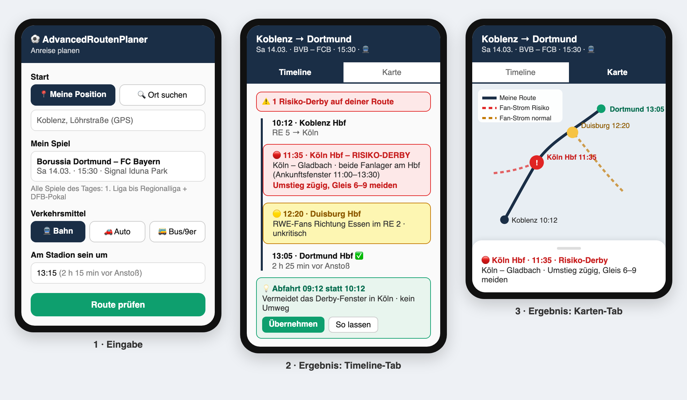

# ⚽ AdvancedRoutenPlaner

Routenplaner für Fußball-Spieltage: plant die Anreise zum Spiel und zeigt, wo sich die eigene Route mit den Anreise-Routen anderer Fanlager kreuzen kann – auf der Schiene und auf der Straße. Das Ziel: **Konflikte bei der Anreise gar nicht erst entstehen lassen.**

## 💡 Die Idee

Wer am Spieltag zum Fußball fährt, kennt das Problem: Auf einmal steht man mit dem Fanlager eines ganz anderen Spiels im selben Zug oder an derselben Raststätte. Der AdvancedRoutenPlaner schaut sich **alle Fußballspiele des Tages** an, berechnet daraus die Fan-Ströme auf Schiene und Straße und prüft die eigene Route dagegen – damit man vorher weiß, was einen unterwegs erwartet, und rechtzeitig ausweichen kann.

## 📱 UI-Entwurf (MVP)

1. **Eingabe**: Start per GPS-Position oder Ortssuche, Spiel auswählen, Verkehrsmittel (Bahn / Auto / Bus–9-Sitzer), gewünschte Ankunftszeit am Stadion
2. **Timeline-Tab**: die Route als Zeitstrahl – Konfliktpunkte stehen genau da, wo sie auf der Fahrt passieren
3. **Karten-Tab**: dieselbe Route auf der Karte, fremde Fan-Ströme als gestrichelte Linien, Details im Sheet unten

## 🧭 Features (MVP)

### Fan-Strom-Modell

- **Abdeckung: 1. Bundesliga bis Regionalliga + DFB-Pokal** – gerade in den unteren Ligen sind große, teils risikobehaftete Fanszenen unterwegs
- Man gibt nur die **eigene Fahrt** ein (Spiel, Start, Verkehrsmittel) – wie die anderen Fanlager anreisen, weiß niemand. Deshalb wird **jedes fremde Fanlager auf allen Verkehrsmitteln gleichzeitig modelliert**: ein Teil in Zügen über die typischen Bahn-Korridore, ein Teil mit Bus, 9-Sitzer oder Auto über die Autobahnen – mit jeweils eigenen Fahrzeiten und damit **mehreren Zeitfenstern pro Streckenabschnitt**
- Faustregel: Fanlager wollen **ca. 2 bis 2,5 Stunden vor Anpfiff** am Stadion sein; davon wird rückwärts gerechnet, wann welcher Fan-Strom wo ist
- Die eigene Route wird gegen alle Zeitfenster geprüft, die einen physisch treffen können: Bahnfahrer gegen die Bahn-Anteile der Fan-Ströme, Auto-/Busfahrer gegen die Straßen-Anteile

### Bekannte Infos eintragen

- Wenn man etwas über die Anreise eines Fanlagers **weiß**, kann man es eintragen – z. B. „Hamburg fährt mit angekündigtem Sonderzug, Abfahrt 09:40" oder „Fanclub-Konvoi über die A7"
- Eingetragene Infos **ersetzen die Schätzung** für dieses Fanlager: statt aller angenommenen Zeitfenster rechnet das Tool dann mit der echten Verbindung und Abfahrtszeit
- Für die restlichen Fanlager ohne Infos gilt weiter das Schätzmodell

### Konfliktpunkte auf der eigenen Route

- **Schiene**: Bahnhöfe, Umstiege und Zugverbindungen, auf denen sich Fanlager begegnen können
- **Straße**: Autobahnabschnitte und Raststätten, an denen sich Anreise-Routen überschneiden
- **Zwei Warnstufen**: normale Fan-Kreuzungen als Info (🟡), **Risiko-Derbys deutlich markiert** (🔴) – dafür pflegt das Tool eine Liste von Rivalitäten und Risikopaarungen

### Vorschläge statt nur Warnungen

- **Alternative Route oder andere Abfahrtszeit**, wenn das mit vertretbarem Aufwand geht
- Wenn die Alternative ein großer Umweg wäre (z. B. für Fanclubs im Bus, die nicht mal eben anders fahren): **Verhaltenshinweise statt Umweg** – „auf diesem Abschnitt aufpassen", „an dieser Raststätte nicht anhalten", „diesen Umstieg zügig durchlaufen"
- Das Tool zwingt nie auf einen 90-Minuten-Umweg: ausweichen, wenn billig – sonst informiert durchfahren

## 🔭 Ausbaustufen

- **Live-Begleitung unterwegs**: Das Tool läuft während der Fahrt mit und reagiert auf Verspätungen und kurzfristige Spielverlegungen – „Achtung, durch deine Verspätung liegst du jetzt im Zeitfenster von …" als Push-Warnung

## 🚧 Status & Herausforderungen

Das Projekt ist aktuell in der Ideen-Phase. Bekannte Knackpunkte:

- Spielplan-Daten für die Regionalligen sind schwerer maschinell zu beschaffen als für Liga 1–3
- Die Rivalitäten-/Risikopaarungs-Liste braucht laufende Pflege
